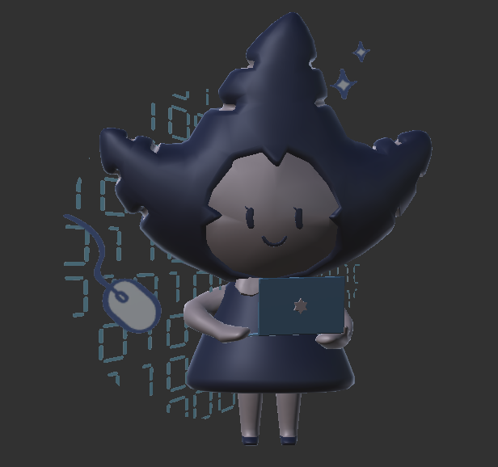
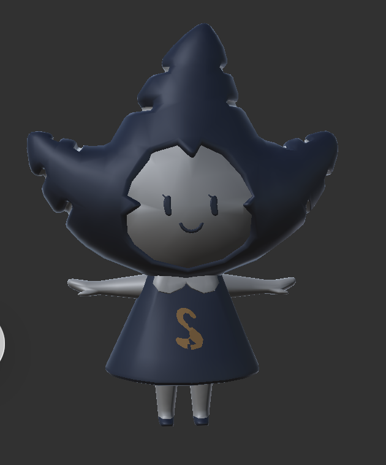

# 파이프라인 설계: 건물 신호와 마스코트 데이터 연결

프렌즈 눈송에서는 건물 구역에 들어가면 AR 마스코트가 등장합니다. Major 마스코트가 뽑히면 해당 건물의 Entry를 사용하고, 수집한 마스코트는 도감에 기록됩니다. 위치 판정과 `ScriptActivationController` 활성화는 팀원이 만든 시스템입니다. 제가 맡은 부분은 활성화된 건물 정보를 마스코트 데이터에 연결하고, 생성된 마스코트를 수집 시점에 다시 식별하는 흐름입니다.

```text
활성 Controller → 건물 키 → 마스코트 선택
                         ├─ Major: 건물별 Entry → GameObject + Entry → AR 수집 → 도감 갱신
                         └─ Normal: 공통 Prefab → GameObject + null → Normal 마스코트 대화
```

## 처음 구현한 방식 (2024)

[`86f0eb86`](https://github.com/dazzang22/Noonsong-Client-Optimization/commit/86f0eb86)의 `ARObjectSpawn.cs`에서는 활성 Controller 이름을 `GetBuildingNameFromScript()`로 변환한 뒤, 기존 `NoonsongEntry.buildingName`과 비교했습니다. 이름을 바로 대조하는 현재 방식과는 다릅니다. 당시에는 Spawn할 때마다 전체 Entry 목록을 순회해 해당 건물의 후보를 모았습니다. 아래는 건물명 변환과 후보 비교 부분에서 각각 한 줄씩 발췌한 것입니다.

```csharp
string buildingName = GetBuildingNameFromScript(ScriptActivationController.activatedScriptName);
```

```csharp
if (entry.buildingName == buildingName)
{
    filteredEntries.Add(entry);
}
```

2024년 코드에서는 60% 확률로 해당 건물의 Major 후보를 시도하고, 나머지는 Normal을 선택했습니다. Major 후보가 비어 있으면 Normal로 넘어가도록 처리했습니다.

**Major / Normal 마스코트 예시 · 현재 게임 화면**

| Major · 건물 Entry와 연결 | Normal · Entry 없는 마스코트 |
|:---:|:---:|
|  |  |

## 전체 탐색에서 건물별 Dictionary 조회로 (2026)

처음 방식은 마스코트를 Spawn할 때마다 **순차 탐색**으로 전체 Entry를 다시 훑고 새 목록을 만들었습니다. [현재 `PlayerObjectSpawn.cs`](../Assets/Scripts/ObjectSpawn/PlayerObjectSpawn.cs)는 시작 시 `BuildEntryCache()`에서 유효한 Entry를 `Dictionary<string, List<NoonsongEntry>>`에 건물별로 모읍니다. Spawn 시에는 부모 `ScriptActivationController`의 GameObject 이름을 건물 키로 읽고 `TryGetValue()`로 후보를 찾습니다.

```csharp
if (entriesByBuilding != null && entriesByBuilding.TryGetValue(buildingName, out var entries))
{
    return entries;
}
return EmptyEntries;
```

건물 키가 없으면 공유 빈 목록을 반환합니다. 이 조회 방식 변경은 [`0c87cdff`](https://github.com/dazzang22/Noonsong-Client-Optimization/commit/0c87cdff)에서 확인할 수 있습니다. 반복적인 전체 순회를 피하기 위한 변경입니다.

## 생성 객체와 원본 Entry 연결

화면에 보이는 `GameObject`만 저장하면 AR 수집 단계에서 어느 도감 Entry의 마스코트인지 다시 알아내야 합니다. 전역 단일 Spawn 정책과 `PlayerObjectSpawnManager`의 초기 구현은 팀원 작업입니다. 저는 생성 시 `SpawnedObject`에 실제 객체와 원본 `NoonsongEntry`를 함께 넣어 Manager 목록에 등록했습니다.

```csharp
ownedSpawnedObject = new SpawnedObject(instance, spawnedObject.NoonsongEntry);
```

[`ARObjectCatch`](../Assets/Scripts/CollectionScene/ARObjectCatch.cs)는 화면에서 선택한 객체를 Manager 목록의 `GameObject`와 비교해 같은 `SpawnedObject`를 찾습니다. Entry가 있으면 그 마스코트의 조우 화면으로 이어지고, 수집이 확정되면 [`NoonsongManager.DiscoverItem()`](../Assets/Scripts/CollectionScene/NoonsongManager.cs)이 클라이언트 발견 상태를 바꾼 뒤 도감 UI를 갱신합니다. Normal 마스코트는 Entry가 `null`인 경로로 구분합니다. 서버 저장·불러오기는 팀원이 맡았습니다.

현재 건물 키는 Controller의 GameObject 이름을 그대로 씁니다. 이름과 `buildingName`이 다르면 후보를 찾지 못합니다. 캐시도 시작할 때 한 번 만들기 때문에 실행 중 Entry가 바뀌면 다시 만들어야 합니다.
