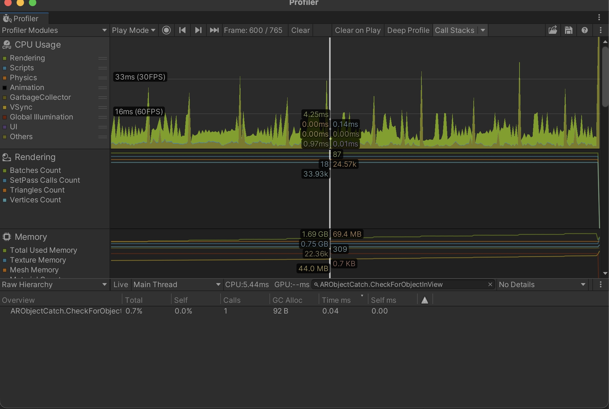
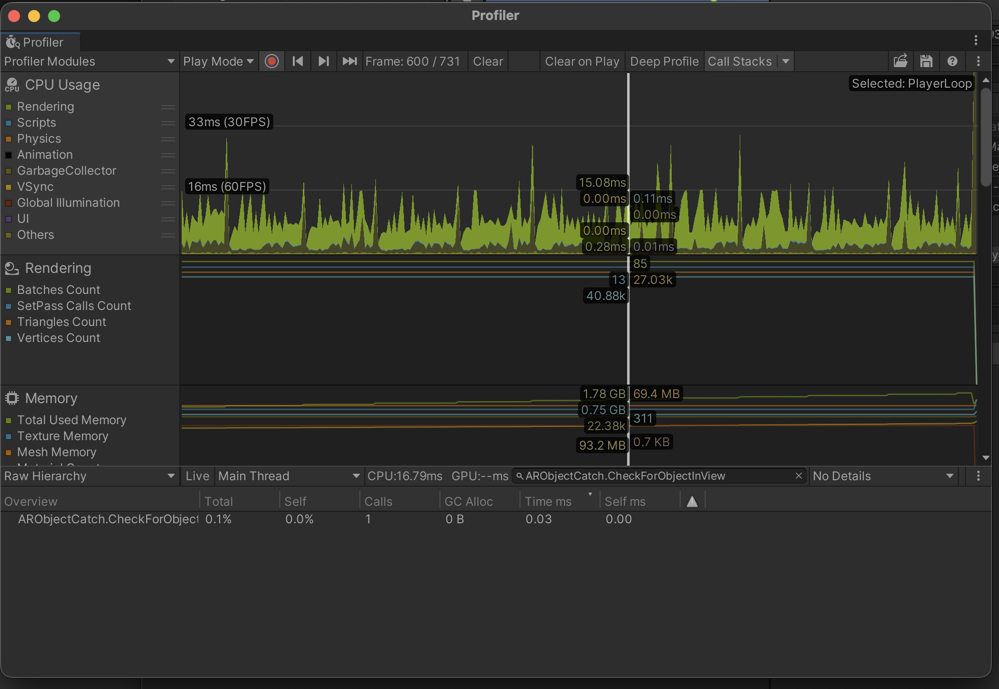
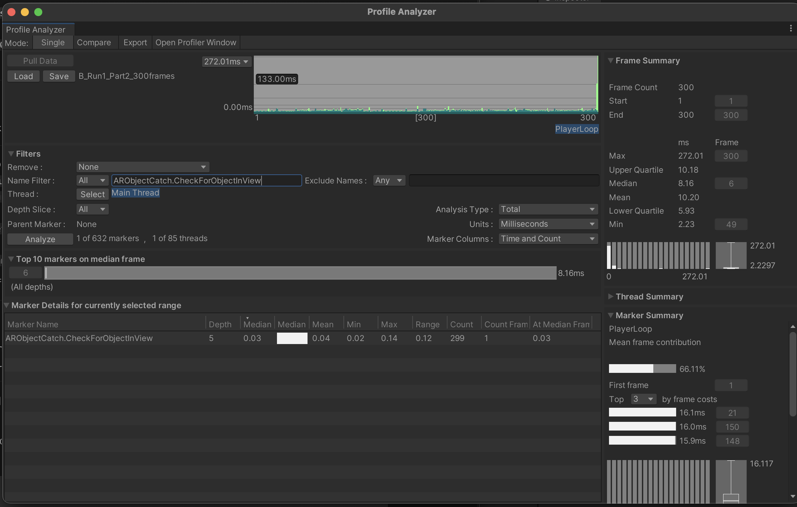
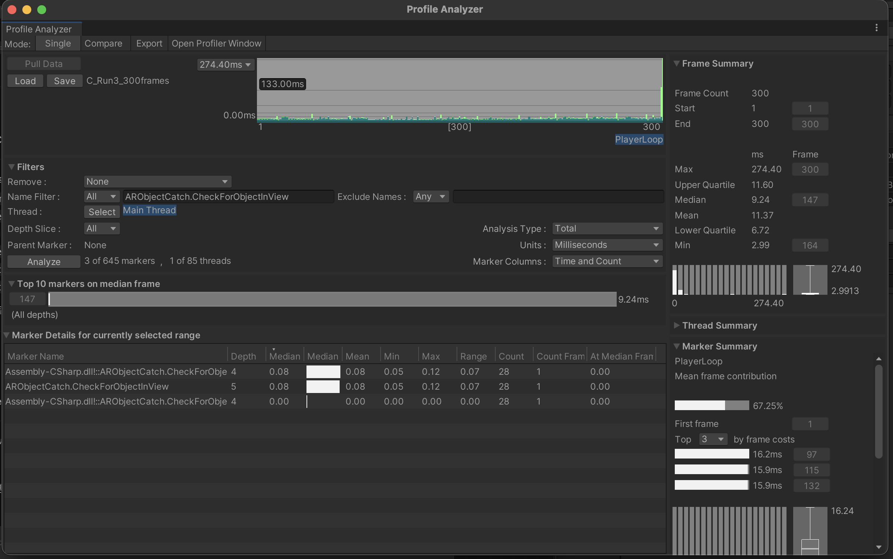

# AR 객체 탐지 비용 측정

## 왜 측정했나

2025년 라이브 운영 때 오래 플레이하면 발열이 심해지고 마스코트 생성이 멈춘다는 보고가 있었습니다. 두 증상의 원인은 확인되지 않았습니다. 다만 화면에 변화가 없어도 AR 객체 탐지가 매 프레임 실행되는 코드를 발견해, 이 부분부터 측정했습니다.

## A/B/C로 나눠서 비교

현재 [`ARObjectCatch.cs`](../Assets/Scripts/CollectionScene/ARObjectCatch.cs)에 측정용 A/B/C 분기를 두었습니다. 배열 생성과 탐지 간격을 한 번에 바꾸면 어느 쪽의 영향인지 알 수 없어서 순서대로 나눴습니다.

| Variant | Array | Frequency | Purpose |
|---|---|---|---|
| A | 매 호출 `new Vector3[5]` | 매 프레임 | 기존 반복 할당 재현 |
| B | `checkPoints` 재사용 | 매 프레임 | allocation 변화 분리 |
| C | `checkPoints` 재사용 | 0.1초 간격 | 호출 빈도 변화 분리 |

`ProfilerMarker("ARObjectCatch.CheckForObjectInView")`로 같은 탐지 구간을 표시했습니다.

```csharp
private void RunDetectionBenchmarkSample()
{
    using (DetectionMarker.Auto())
    {
        UpdateCurrentTarget();
    }
}
```

## 배열을 재사용했을 때

| Condition | GC Alloc |
|---|---:|
| A · 새 `Vector3[5]` 생성 | 92 B/call |
| B · 배열 재사용 | 0 B/call |

탐지 Marker 안에서 한 번 호출할 때 생긴 할당량입니다. 게임 전체의 GC Alloc 수치는 아닙니다.

Profiler에서 A와 B의 한 프레임씩 골라 비교했습니다. 이미지를 누르면 원본 크기로 볼 수 있습니다.

| A · 92 B/call | B · 0 B/call |
|:---:|:---:|
| <a href="images/runtime-a-92b.png"></a> | <a href="images/runtime-b-0b.png"></a> |

## 탐지 간격을 바꿨을 때

Profile Analyzer에서 조건마다 300프레임을 3회씩 측정했습니다.

| Metric | Before | After |
|---|---:|---:|
| Detection calls/sec · median | 95.5 | 8.2 |
| Reduction |  | 약 91.4% |

초당 호출 수는 `Marker Count ÷ (Frame Count × Mean frame time)`으로 계산했습니다. 표의 값은 3회 측정의 중앙값이며, 포트폴리오에 쓴 `95.5 → 8.2 calls/sec`, `91.4% 감소`와 같습니다.

아래 캡처는 측정 구간 중 B와 C를 하나씩 고른 것입니다. B에서는 300프레임 동안 299회, C에서는 28회 호출됐습니다. 이 두 장은 호출 방식의 차이를 보여주고, 위 중앙값 전체를 대신하지는 않습니다.

| B · 매 프레임 탐지 유지 | C · 0.1초 간격 탐지 |
|:---:|:---:|
| <a href="images/runtime-b-300frames.png"></a> | <a href="images/runtime-c-300frames.png"></a> |

## 확인한 것과 확인하지 못한 것

배열을 재사용한 뒤 이 Marker의 호출당 할당이 0 B로 표시됐고, 탐지 간격을 둔 뒤 호출 수도 줄었습니다. CPU 시간은 Profiler 화면에서 차이를 읽기 어려워 개선 수치로 쓰지 않았습니다. 실제 기기의 온도·소비 전력은 측정하지 않았고, Spawn 중단 원인도 이 실험만으로 확인할 수 없습니다.

`.pdata` 원본은 Unity에서 열어야 합니다. 위 PNG는 일부 구간을 보여주는 캡처입니다.

## 관련 커밋

- [`0e72016c`](https://github.com/dazzang22/Noonsong-Client-Optimization/commit/0e72016c) — test spawn mode and AR detection optimization
- [`0c87cdff`](https://github.com/dazzang22/Noonsong-Client-Optimization/commit/0c87cdff) — Entry cache
- [`f468f5c4`](https://github.com/dazzang22/Noonsong-Client-Optimization/commit/f468f5c4) — target detection refactor
- [`85a53c41`](https://github.com/dazzang22/Noonsong-Client-Optimization/commit/85a53c41) — benchmark variants
- [`191447e7`](https://github.com/dazzang22/Noonsong-Client-Optimization/commit/191447e7) — detector instance logging
