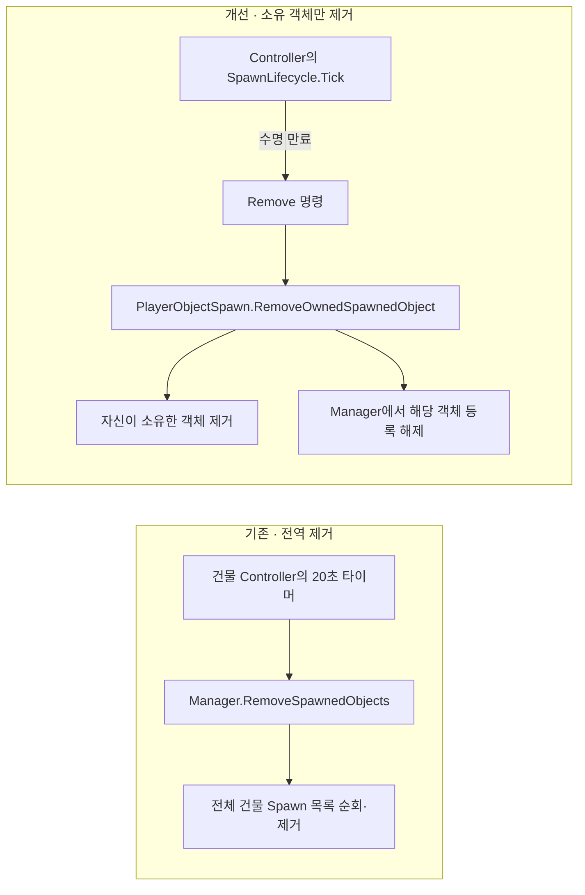
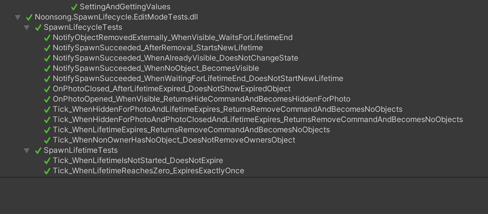

# 생성한 객체는 생성한 Controller가 제거하도록

이 작업은 2026년에 원 프로젝트를 다시 살펴보며 개선한 내용입니다. 2024–2025년에 만든 기능과는 시점을 구분해 적었습니다.

## 왜 바꿨나

기존에는 각 건물 Controller가 자기 타이머로 20초를 세다가, 시간이 끝나면 Manager의 전역 제거 함수를 불렀습니다. 실제로 한 번에 생성할 수 있는 객체는 최대 하나였지만, 타이머를 가진 Controller와 객체를 제거하는 범위가 달랐습니다. 그래서 누가 만든 객체인지와 누가 제거할지를 코드에서 분명히 하기로 했습니다.

여기서 다루는 것은 앞으로 여러 Controller의 객체가 함께 생길 때 드러날 수 있는 위험입니다. 과거 라이브 운영 중 발생한 Spawn 중단의 원인이라고 확인한 것은 아닙니다.

## 제거 책임의 변화



Manager는 지금 새 객체를 생성해도 되는지 판단하고 목록을 관리합니다. 20초가 끝나면 해당 Controller가 자기 객체만 제거합니다. 수집으로 객체가 먼저 사라진 경우에는 바로 다음 객체를 만들지 않고, `WaitingForLifetimeEnd`에서 남은 시간을 채웁니다. 20초 주기는 기존 기획 규칙입니다.

## 20초 동안 상태가 바뀌는 방식

`SpawnLifecycle`은 20초 타이머와 현재 상태를 관리합니다. Unity 객체를 직접 건드리는 대신 필요한 동작을 명령으로 돌려줍니다.

```text
NoObjects
  └─ spawn succeeded → Visible

Visible
  ├─ photo opened → HiddenForPhoto
  ├─ removed externally → WaitingForLifetimeEnd
  └─ expired → NoObjects + Remove

HiddenForPhoto
  ├─ photo closed → Visible + Show
  └─ expired → NoObjects + Remove
```

`PlayerObjectSpawn`은 그 명령을 받아 실제 객체를 숨기거나, 다시 보이게 하거나, 제거합니다. 상태 계산을 Unity 객체 조작과 떼어내서 EditMode에서 따로 테스트할 수 있게 했습니다.

## 역할 나누기

- Controller는 자신이 생성한 `ownedSpawnedObject`를 보관합니다.
- Manager는 전역 Spawn 가능 여부와 `slotOwner`를 관리합니다.
- 만료 시 Controller는 자신이 소유한 객체만 제거합니다.
- 조우 중인 객체는 화면에서 즉시 제거하지 않더라도 필드 슬롯과 registry를 정리합니다.

## 확인한 동작

수명과 상태 전이를 확인하는 EditMode 테스트는 총 13개입니다.

- `SpawnLifetimeTests`: 2
- `SpawnLifecycleTests`: 11

20초 만료, 사진 모드 전환, 수집 등으로 객체가 먼저 사라진 경우, 중복 제거 알림, 만료 후 다음 생성 가능 상태를 테스트했습니다. 다른 Controller의 객체를 건드리지 않는지도 순수 로직 범위에서 확인했습니다. 실제 Unity `GameObject` 생성·제거까지 통합 검증한 테스트는 아닙니다.

2026년 10월 16일 Unity Test Runner에서 위 13개 EditMode 테스트가 모두 통과한 화면입니다. 캡처 이후 변경된 최신 코드에 대해서는 다시 실행한 결과가 없습니다.



## AI를 사용한 부분

상태 전이 코드와 테스트를 만들 때 AI 도구의 도움을 받았습니다. 저는 기존 코드에서 제거 범위가 넓다는 점을 확인하고, 게임의 20초 규칙에 맞는지 검토했습니다. 실패할 수 있는 상황과 기대 동작도 정리했습니다. 위 캡처는 10월 16일 실행 결과이며, 이후 코드에 대한 재실행은 확인하지 못했습니다.

## 관련 커밋

- [`01948f81`](https://github.com/dazzang22/Noonsong-Client-Optimization/commit/01948f81) — lifetime tracking
- [`6cd8ef7f`](https://github.com/dazzang22/Noonsong-Client-Optimization/commit/6cd8ef7f) — state machine
- [`173d783a`](https://github.com/dazzang22/Noonsong-Client-Optimization/commit/173d783a) — overlap contract
- [`0135959e`](https://github.com/dazzang22/Noonsong-Client-Optimization/commit/0135959e) — encounter-aware lifecycle
